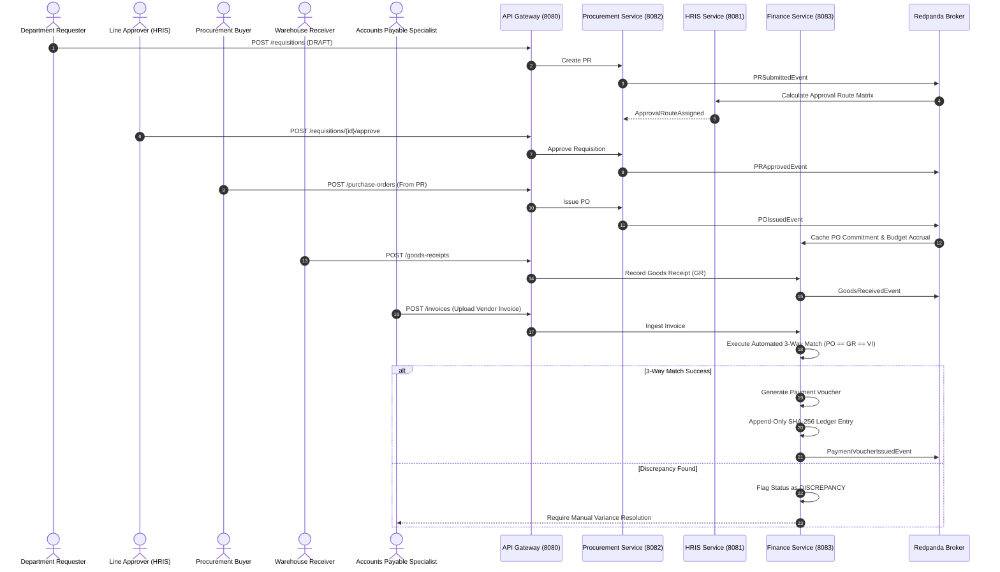
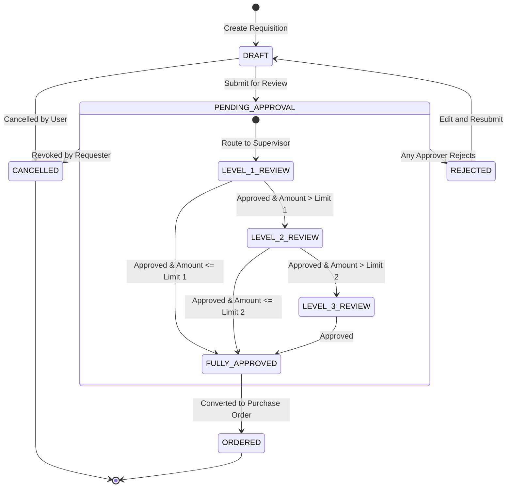
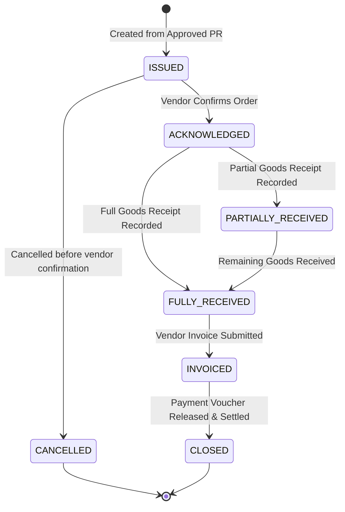
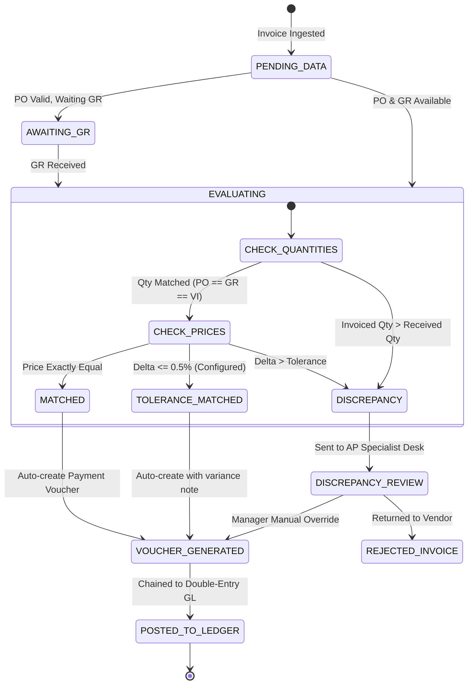

# Application Flows, State Machines & Screen Navigation

## APEX-Core (Asynchronous Procurement & Enterprise Exchange Core)

---

## 1. End-to-End Business User Flows

### 1.1. Procurement-to-Pay (P2P) Lifecycle



---

## 2. State Machine Specifications

### 2.1. Purchase Requisition (PR) State Machine



---

### 2.2. Purchase Order (PO) State Machine



---

### 2.3. 3-Way Matching Engine State Machine



---

## 3. Screen & Navigation Sitemap

```
APEX-Core Web Application
├── /login                              # Enterprise SSO / JWT Login
├── /dashboard                          # Executive Overview, Approvals KPI, Budget Status
│
├── /procurement                        # Procurement Module
│   ├── /requisitions                   # Purchase Requisition List (Filter by Status, Dept)
│   │   ├── /new                        # Create Requisition Form (Line items grid, Cost Center selector)
│   │   └── /{id}                       # PR Details, Approval Timeline, Activity Log
│   ├── /orders                         # Purchase Orders List (PO)
│   │   └── /{id}                       # PO Details, Contract PDF, Delivery Progress
│   └── /vendors                        # Vendor Directory, Tax Compliance, Rating
│
├── /warehouse                          # Warehouse & Logistics Module
│   ├── /goods-receipts                 # Historical Goods Receipts (GR)
│   └── /goods-receipts/new             # Physical Verification & Delivery Order Intake Form
│
├── /finance                            # Finance & Accounts Payable Module
│   ├── /invoices                       # Inbound Vendor Invoices
│   │   ├── /upload                     # Upload Invoice (PDF / Manual Intake / OCR)
│   │   └── /{id}/match-view            # 3-Way Match Visual Comparison (PO vs GR vs Invoice)
│   ├── /payment-vouchers               # Approved Payment Vouchers
│   └── /general-ledger                 # Double-Entry General Ledger
│       └── /verify                     # Cryptographic Hash Chain Verification Screen
│
└── /organization                       # HR & Governance Module (Admin/Approver)
    ├── /employees                      # Employee Directory & Supervisor Relationships
    ├── /cost-centers                   # Cost Center Budgets & Real-time Utilization
    └── /approval-matrices              # Approval Limit Threshold Configuration
```
