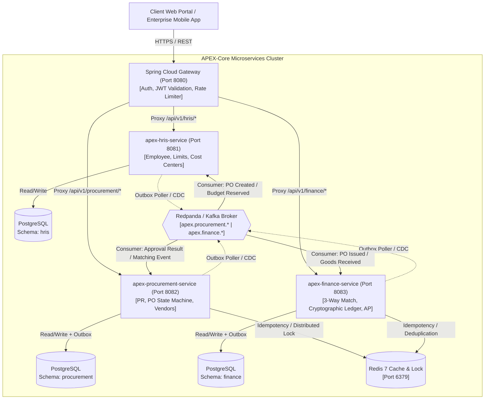

# System Architecture & Engineering Blueprint
## APEX-Core (Asynchronous Procurement & Enterprise Exchange Core)

---

## 1. High-Level Architectural Patterns

APEX-Core is built upon modern architectural pillars designed for high-concurrency enterprise scale:

1. **Domain-Driven Design (DDD) & Microservices Boundaries:**
   Each service encapsulates an independent bounded context with isolated storage (**Database-per-Service**), decoupling the lifecycles of HRIS, Procurement, and Financial Settlement.
2. **Event-Driven Architecture (EDA) via Redpanda / Apache Kafka:**
   Inter-service communication is asynchronous for state mutations and multi-step workflows, eliminating temporal coupling and blocking HTTP cascades.
3. **Transactional Outbox Pattern:**
   Eliminates dual-write anomalies by persisting domain events into local `outbox_events` tables within the same database transaction as domain entities, before streaming to the message broker.
4. **Choreography-based Saga Pattern:**
   Distributed business transactions are decentralized using domain event reactions and automated **Compensating Transactions** upon rejection or validation failure.
5. **Command Query Responsibility Segregation (CQRS) Light:**
   State mutations (Commands) route through domain aggregates with optimistic concurrency checks, while read queries utilize Redis caching and indexed projections.

---

## 2. High-Level System Architecture Diagram



---

## 3. Communication Protocols & Inter-Service Interaction

### 3.1. Synchronous vs Asynchronous Boundary

* **Synchronous (REST / HTTP 2):**
  * Client portal communication through **Spring Cloud Gateway**.
  * Read-only queries, such as vendor catalog lookups or remaining Cost Center balance checks.
* **Asynchronous (Event Streaming):**
  * Cross-domain state mutations:
    * `PurchaseRequisitionSubmittedEvent`
    * `BudgetReservationRequestedEvent`
    * `PurchaseOrderApprovedEvent`
    * `GoodsReceivedEvent`
    * `ThreeWayMatchCompletedEvent`
    * `PaymentVoucherGeneratedEvent`
  * Standardized using CloudEvents-compliant JSON envelopes.

---

## 4. Multi-Module Project & Folder Hierarchy

The repository is structured as a Maven Multi-Module monorepo:

```
apex-core/
├── .github/
│   └── workflows/
│       ├── build-and-test.yml           # CI/CD Pipeline (Unit & Integration)
│       └── stress-test-k6.yml           # Automated concurrency benchmark
├── docs/                                # Technical & Architectural Documentation
│   ├── OVERVIEW.md                      # Executive spec & architectural overview
│   ├── PRD.md                           # Product requirements & user stories
│   ├── ARCHITECTURE.md                  # High-level architecture (This file)
│   ├── DESIGN_SYSTEM.md                 # UI/UX design tokens & guidelines
│   ├── INTEGRATION.md                   # API & Webhook contracts
│   ├── TSD.md                           # Database schemas & algorithm designs
│   ├── SECURITY_GUIDE.md                # Security & RBAC matrix
│   ├── APP_FLOW.md                      # Flowcharts & state machines
│   ├── IMPLEMENTATION_PLAN.md           # Roadmap & task checklist
│   └── TESTING_GUIDE.md                 # Testing standards & mock rules
├── deploy/                              # Local & staging infrastructure
│   ├── docker-compose.yml               # Postgres, Redis, Redpanda containers
│   └── init-db/
│       └── 01-create-schemas.sql        # Creates hris, procurement, finance schemas
├── apex-common-core/                    # Shared library across services
│   ├── pom.xml
│   └── src/main/java/com/apex/common/
│       ├── domain/                      # Value Objects (Money, EventEnvelope)
│       ├── exception/                   # Global RFC 7807 Error Handlers
│       ├── idempotency/                 # Redis Idempotent Consumer Aspect
│       └── outbox/                      # Generic Transactional Outbox Entity & Repository
├── apex-gateway/                        # Spring Cloud Gateway (Port 8080)
│   ├── pom.xml
│   └── src/main/
│       ├── java/com/apex/gateway/       # Route Predicates, JWT Auth Filter, RateLimiter
│       └── resources/application.yml
├── apex-hris-service/                   # HR & Org Hierarchy Service (Port 8081)
│   ├── pom.xml
│   └── src/main/
│       ├── java/com/apex/hris/          # Employees, CostCenters, ApprovalMatrix Engine
│       └── resources/db/migration/      # Flyway SQL migrations (schema: hris)
├── apex-procurement-service/            # Procurement & PO Service (Port 8082)
│   ├── pom.xml
│   └── src/main/
│       ├── java/com/apex/procurement/   # PR, PO, Vendors, State Machine, Outbox Worker
│       └── resources/db/migration/      # Flyway SQL migrations (schema: procurement)
├── apex-finance-service/                # Accounts Payable & GL Service (Port 8083)
│   ├── pom.xml
│   └── src/main/
│       ├── java/com/apex/finance/       # 3-Way Matching Engine, Cryptographic GL, Vouchers
│       └── resources/db/migration/      # Flyway SQL migrations (schema: finance)
└── pom.xml                              # Root Parent POM (Java 21, Spring Boot 3.3.x BOM)
```

---

## 5. Resource Constraints & Optimization Strategy (8 GB RAM)

The entire microservice mesh is engineered to run locally within an 8 GB RAM developer workstation:

```
Maximum Memory Allocation Budget (Target: ~1.85 GB RAM Total):
┌──────────────────────────────────────┬───────────────────────┐
│ Component                            │ Maximum Memory Limit  │
├──────────────────────────────────────┼───────────────────────┤
│ PostgreSQL 16 (Multi Logical Schema) │ 200 MB                │
│ Redis 7 In-Memory Cache              │ 80 MB                 │
│ Redpanda (Kafka Drop-in C++)         │ 300 MB                │
│ Spring Cloud Gateway                 │ 192 MB (Heap: 128 MB) │
│ apex-hris-service                    │ 256 MB (Heap: 160 MB) │
│ apex-procurement-service             │ 320 MB (Heap: 192 MB) │
│ apex-finance-service                 │ 320 MB (Heap: 192 MB) │
└──────────────────────────────────────┴───────────────────────┘
```

### JVM Execution Flags
Each Spring Boot application runs with explicit heap parameters:
```bash
-XX:+UseG1GC -XX:+ExitOnOutOfMemoryError -Xms128m -Xmx256m
```
Java 21 **Virtual Threads (Project Loom)** are enabled (`spring.threads.virtual.enabled=true`), achieving high I/O throughput without memory-heavy operating system thread stacks.
