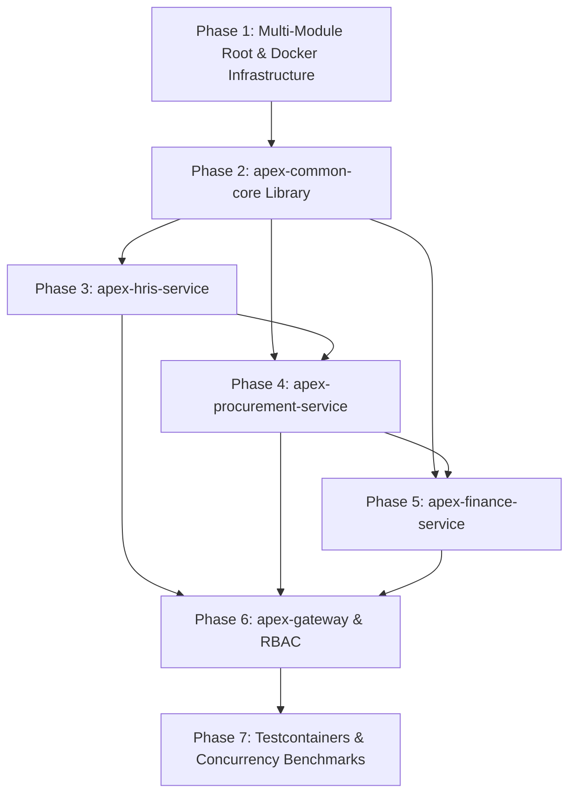

# Implementation Plan & Execution Roadmap

## APEX-Core (Asynchronous Procurement & Enterprise Exchange Core)

---

## 1. Project Milestones & Phase Breakdown

```
Phase 1: Project Scaffolding & Infrastructure Foundation
    └── Multi-module Maven setup, Docker Compose (PostgreSQL, Redis, Redpanda), Flyway init

Phase 2: Common Core & Shared Domain Models
    └── Value objects (Money), RFC 7807 Exception Handlers, CloudEvents Envelope, Outbox Core

Phase 3: apex-hris-service (Organizational Core)
    └── Employee directory, Cost Center allocation, Dynamic Approval Matrix Engine

Phase 4: apex-procurement-service (P2P Ingestion & PO Management)
    └── PR creation, Approval State Machine, Outbox publisher, PO generation

Phase 5: apex-finance-service (Settlement, 3-Way Match & Cryptographic Ledger)
    └── Goods Receipt tracking, Invoice ingestion, 3-Way Matching Engine, Hash Chaining GL

Phase 6: apex-gateway & Security Enforcement
    └── Spring Cloud Gateway, JWT verification, Redis Rate Limiting & Idempotency filter

Phase 7: End-to-End Testing & Concurrency Benchmarking
    └── Testcontainers integration suite, k6 concurrency stress tests (1000 RPS)
```

---

## 2. Task Dependency Graph



---

## 3. Active Work Checklist (In Progress)

> [!NOTE]
> **Checklist Management Protocol:**
> This section maintains the active queue of features currently under development. **Whenever a task is completed and verified, remove the completed item from this checklist.**

- [ ] **Task 3.1:** Implement `apex-procurement-service` (`PurchaseRequisition`, `PurchaseOrder` entities, state machine approval workflow, and outbox polling dispatcher).
- [ ] **Task 4.1:** Implement `apex-finance-service` (`GoodsReceipt`, `VendorInvoice` entities, 3-Way Matching Engine, and append-only SHA-256 `LedgerEntry`).
- [ ] **Task 5.1:** Implement `apex-gateway` (Routing filters for ports 8081, 8082, 8083, Bearer JWT validation, and Redis Token Bucket rate limiter).
- [ ] **Task 6.1:** Automate cross-service integration testing with **Testcontainers** (Kafka + PostgreSQL) and k6 concurrency test scripts.

---

## 4. Step-by-Step Execution Route

### Step 1: Architectural Foundation & Dependencies

1. Configure root POM BOM dependencies to ensure version alignment across microservices.
2. Verify local Docker Compose infrastructure executes within the 600MB container memory budget.

### Step 2: Shared Library (`apex-common-core`)

1. Implement immutable financial representation (`Money` with `BigDecimal` and `HALF_EVEN` rounding).
2. Implement generic Transactional Outbox models ensuring consistent publisher behavior across modules.

### Step 3: HRIS & Procurement Services

1. Connect HRIS approval limits to Procurement via asynchronous event streaming (`APPROVAL_ROUTE_REQUESTED` and `APPROVAL_ROUTE_RESOLVED`).
2. Enforce optimistic locking via `@Version` on PR status changes.

### Step 4: Finance Service & Cryptographic Engine

1. Implement the 3-Way Matching engine with configurable decimal variance tolerance.
2. Bind general ledger entries using SHA-256 hash chains for non-repudiation audit compliance.

### Step 5: API Gateway & End-to-End Verification

1. Route external requests through the Gateway, preventing IDOR/BOLA via token subject evaluation.
2. Execute high-concurrency benchmarks to verify deadlock-free processing under high load.
